# 📦 SIP BARANG — Sistem Informasi Operasional Penjualan & Inventaris Barang (POS)

**SIP Barang** adalah aplikasi web operasional toko ritel terpadu berbasis **Next.js (TypeScript)** dan **PostgreSQL (Supabase)** dalam mode **Full Online Cloud** yang dirancang untuk mengelola inventaris barang gudang, pencatatan mutasi stok atomik, transaksi kasir *Point of Sale* (POS) dengan dukungan **QRIS Dinamis (EMVCo CRC-16)** & **Printer Struk Thermal Bluetooth (ESC/POS)**, serta laporan keuangan yang dapat dicetak maupun diekspor ke Excel/CSV.

---

## ✨ Fitur Utama (Berdasarkan Hak Akses Peran)

Aplikasi ini menerapkan **Role-Based Access Control (RBAC)** dengan **2 peran pengguna** yang terisolasi per toko (`owner_id`):

### 1. Peran Administrator / Pemilik Toko (`admin`)
- **Dashboard Analitik Real-Time**: Memantau pemasukan harian, total penjualan, laba bersih (*gross profit*), margin keuntungan, nilai modal & potensi jual aset stok gudang, grafik tren 7/14/30 hari, serta pengawasan stok menipis.
- **CRUD Produk & Kategori Cloud**: Menambah, mengubah, dan menghapus produk (SKU unik per toko, harga modal, harga jual, satuan, batas stok minimum) serta mengelola kategori barang bawaan maupun kategori kustom yang tersinkron ke cloud.
- **Manajemen Mutasi Stok Gudang Atomik**: Mencatat barang masuk (*Restock*), barang keluar, atau stok opname melalui RPC Postgres `adjust_product_stock` dengan penguncian baris (`FOR UPDATE`) dan audit log operator.
- **Pencarian, Filter, & Pagination**: Pencarian instan berdasarkan kode SKU/nama/nomor nota, filter kategori, periode waktu, metode bayar, status stok, serta **Pagination** dinamis.
- **Laporan Transaksi, Ekspor Excel (CSV), & Cetak PDF**: Merekap seluruh nota penjualan, membatalkan nota (`VOIDED` melalui RPC `void_pos_transaction` dengan pengembalian stok otomatis), mengekspor laporan ke **CSV/Excel**, mencetak laporan, dan meninjau ulang struk transaksi.
- **Pengaturan Toko, Struk, QRIS, & Manajemen Kasir**: Mengelola profil pemilik toko, identitas header/footer & ukuran kertas struk (`58mm`/`80mm`) di cloud untuk semua perangkat kasir, unggah QRIS statis/EMVCo toko, rekening transfer bank, serta membuat dan mengelola akun staf kasir melalui Edge Function `tenant-auth`.

### 2. Peran Staf Kasir (`user`)
- **Terminal Kasir (POS) Cepat**: Pencarian barang, scan barcode/SKU (tekan `Enter` untuk tambah otomatis ke keranjang), filter kategori, serta kalkulasi diskon (dibatasi maksimal 25% untuk kasir) dan kembalian tunai dengan pemisah ribuan otomatis.
- **Multi-Metode Pembayaran**: Mendukung **Tunai**, **QRIS Dinamis** (nominal tagihan otomatis terkunci pada QR), **Transfer Bank**, dan **Kartu Debit** dengan eksekusi transaksi atomik melalui RPC `process_pos_sale`.
- **Cetak Struk Nota & Riwayat Shift**: Mencetak struk pembayaran `58mm`/`80mm` melalui browser/PDF atau **Printer Thermal Bluetooth ESC/POS**, serta meninjau rekap transaksi shift sendiri pada menu **Riwayat Shift Saya**.
- **Proteksi Data Finansial**: Staf kasir hanya memiliki akses operasional kasir dan **tidak dapat** melihat harga modal, laba bersih pemilik toko, laporan toko menyeluruh, maupun mengubah data master produk atau stok gudang secara manual.

---

## 🖼️ Tampilan Aplikasi (Screenshots per Section)

### 1. Halaman Autentikasi (`/login`)
Form masuk terpadu untuk **Administrator** dan **Staf Kasir**, dilengkapi tab **Daftar Admin** untuk membuat workspace toko baru serta pintasan **Masuk Demo Dashboard** di pojok kiri atas.

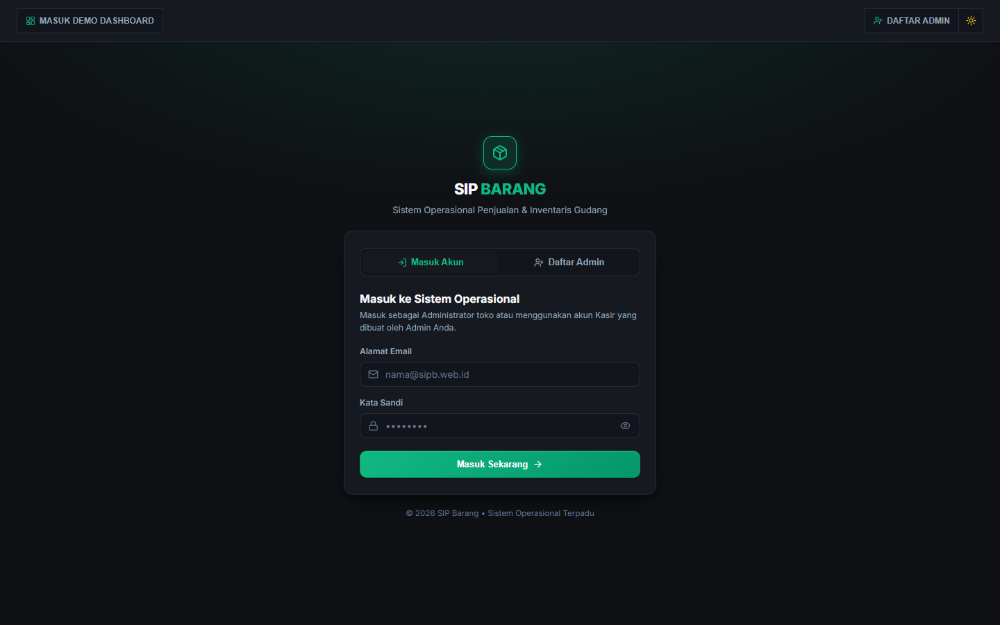

---

### 2. Panel Administrator (`/admin`)

#### 2.1 Dashboard Analitik — Ringkasan KPI (`/admin/dashboard`)
Menampilkan 4 kartu metrik utama (Pemasukan Hari Ini, Total Penjualan & Keuntungan Bersih, Modal Tertanam di Stok, serta Peringatan Stok Menipis).

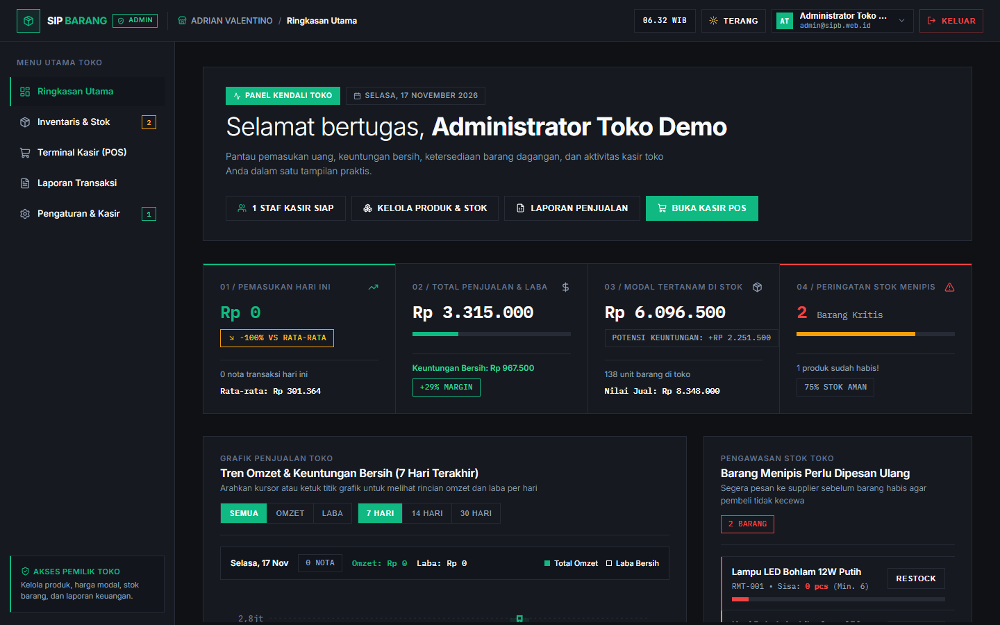

#### 2.2 Dashboard Analitik — Grafik Tren Omzet, Laba, & Pengawasan Stok (`/admin/dashboard`)
Menampilkan grafik interaktif **Tren Omzet & Keuntungan Bersih** (`7 / 14 / 30 Hari`), daftar barang menipis siap *restock*, komposisi pembayaran, dan 5 produk paling cepat terjual.

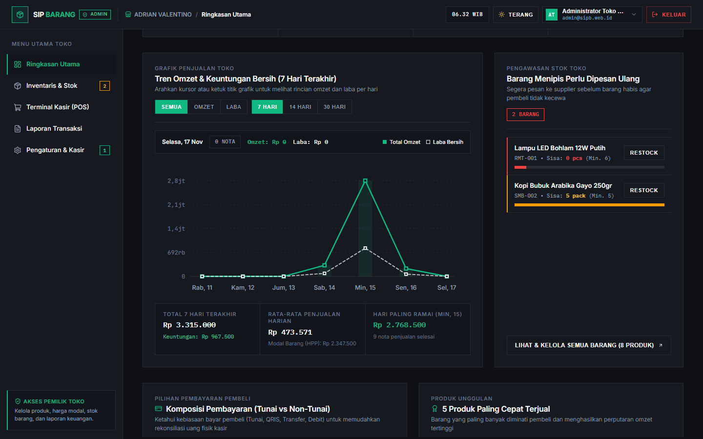

#### 2.3 Manajemen Barang, Kategori, & Pagination (`/admin/produk`)
Pengelolaan katalog produk lengkap dengan harga modal, harga jual, persentase margin otomatis, sisa stok, tombol aksi *restock*/edit/hapus, kelola kategori kustom, dan pagination.

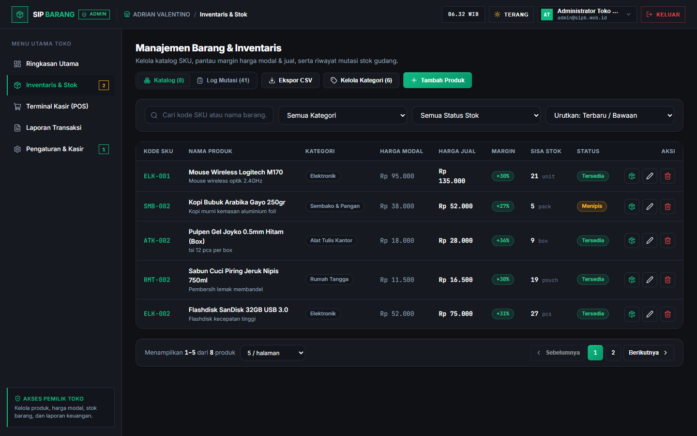

#### 2.4 Riwayat Log Mutasi Stok Gudang (`/admin/produk` — Tab Log Mutasi)
Jejak audit terperinci untuk setiap pergerakan stok (`Stok Masuk`, `Stok Keluar`, `Penyesuaian`), menampilkan stok awal -> stok akhir, alasan/nomor nota, serta email operator.

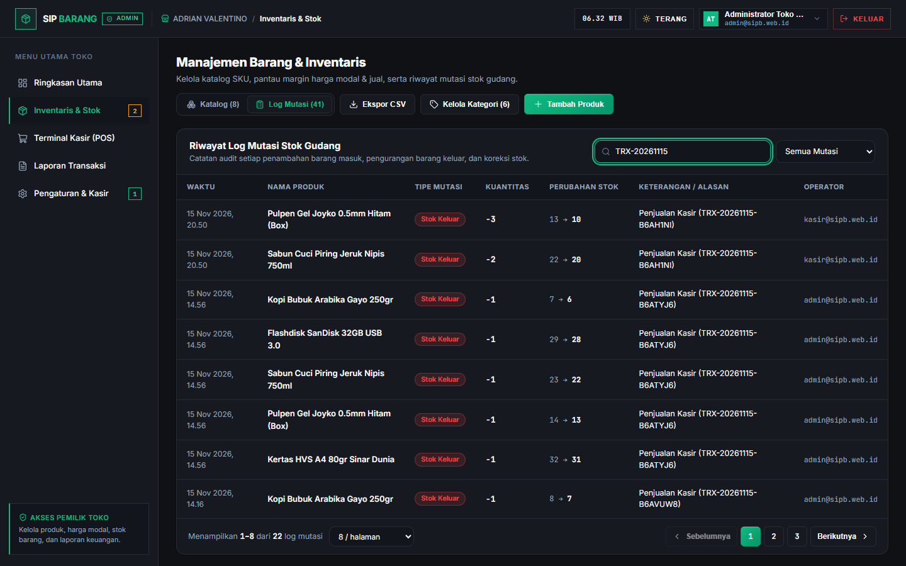

#### 2.5 Laporan Transaksi Penjualan, Ekspor CSV & Cetak Laporan (`/admin/laporan`)
Rekapitulasi seluruh nota penjualan, estimasi laba bersih, pencarian nota/kasir, filter rentang tanggal & metode pembayaran, pembatalan nota (*Void*), serta ekspor CSV/cetak laporan.

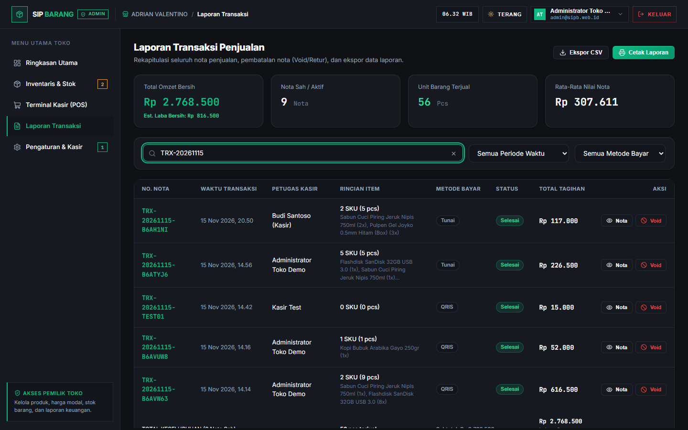

#### 2.6 Pratinjau Struk Nota 58mm/80mm & QRIS Dinamis
Tampilan nota transaksi resmi dengan identitas toko dari cloud, rincian barang, QRIS dinamis sesuai nominal/QR verifikasi nota, cetak langsung ke printer Bluetooth thermal, maupun cetak PDF browser.

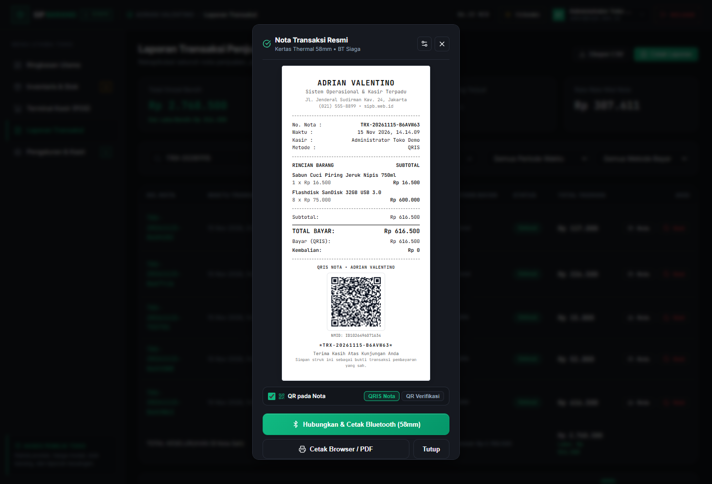

#### 2.7 Pengaturan Profil Admin, Identitas Toko/Struk Cloud, & Unggah QRIS (`/admin/pengaturan`)
Konfigurasi nama pemilik toko, identitas struk (`store_name`, `store_tagline`, `store_address`, `store_phone`, `receipt_footer`, `paper_width`) yang tersimpan di cloud, serta unggah gambar QRIS toko.

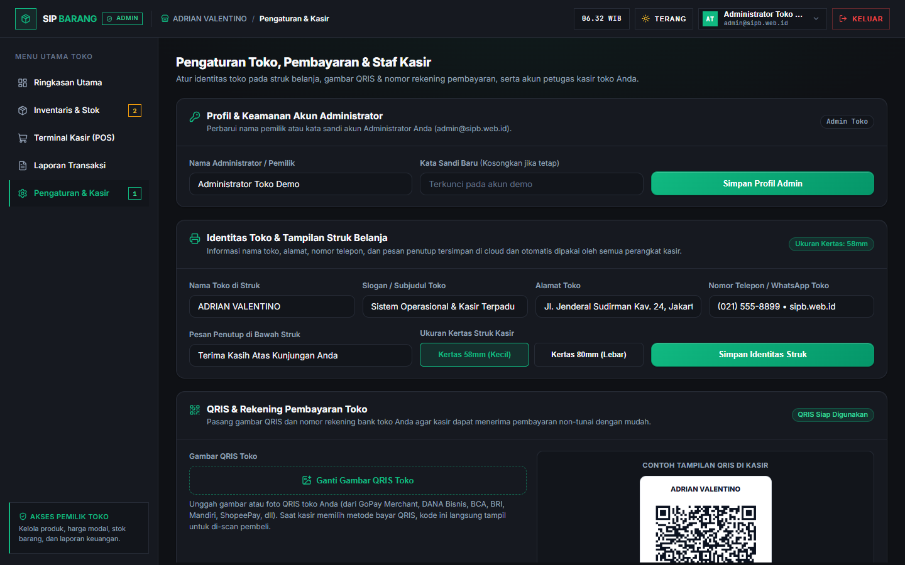

#### 2.8 Tema QRIS, Rekening Bank, & Manajemen Akun Staf Kasir (`/admin/pengaturan`)
Kustomisasi tema tampilan QRIS (`Klasik Nota`, `Biru Modern`, `Hijau Kasir`, `Gelap Elegan`), rekening bank transfer, serta manajemen akun staf kasir (dengan proteksi penguncian pada akun demo publik `kasir@sipb.web.id`).

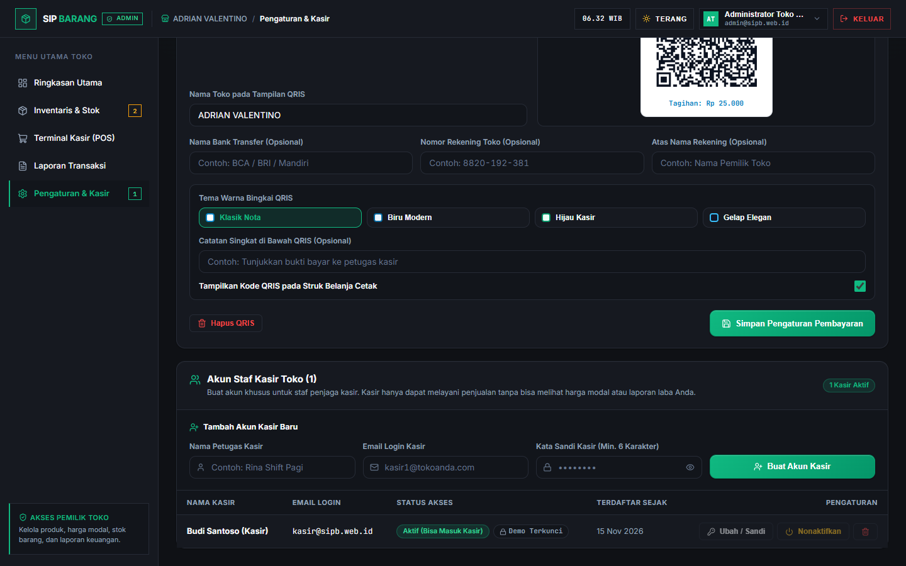

---

### 3. Panel Staf Kasir (`/kasir`)

#### 3.1 Terminal Kasir POS & Keranjang Belanja (`/kasir`)
Antarmuka kasir cepat dengan kartu produk siap ketuk/scan SKU, pencarian instan, keranjang belanja interaktif di sisi kanan, input potongan diskon, dan tombol pembayaran pintas `F8`.

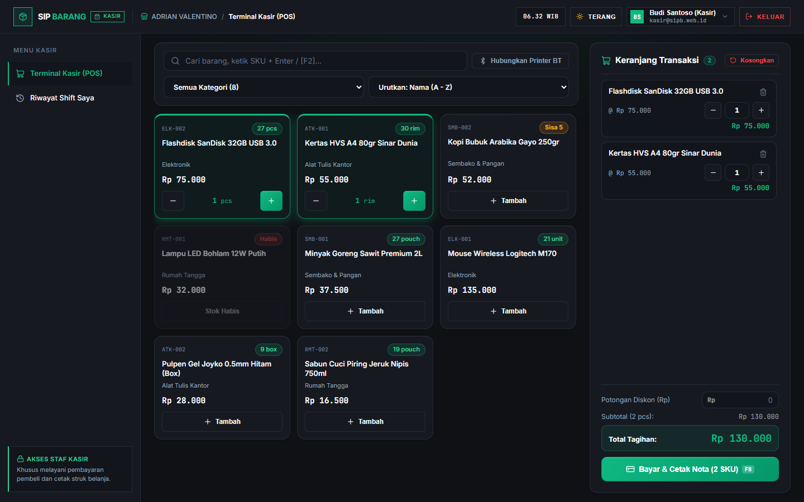

#### 3.2 Penyelesaian Pembayaran & QRIS Dinamis
Modal pembayaran multi-metode (`Tunai`, `QRIS`, `Transfer Bank`, `Kartu Debit`) dengan QRIS dinamis yang mengunci nominal tagihan pas agar pembeli cukup scan dan nominal langsung terisi otomatis.

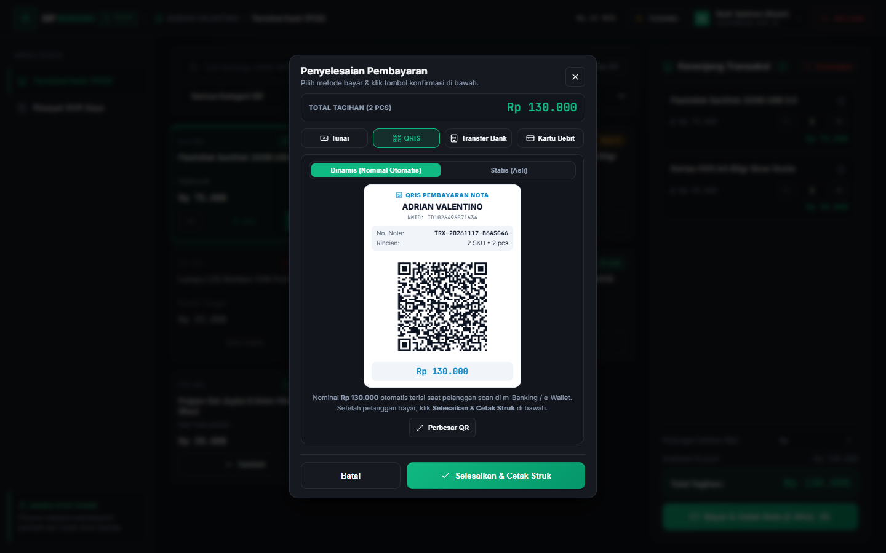

#### 3.3 Riwayat Shift Penjualan Saya (`/kasir/riwayat`)
Halaman khusus staf kasir untuk memantau total penjualan shift aktif, pemisahan penerimaan tunai (kas laci) vs non-tunai, pencarian nota, cetak ulang struk, dan ekspor CSV shift.

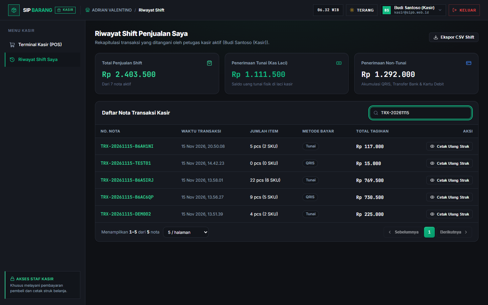

---

## 🔐 Standar Keamanan & Integritas Transaksi

1. **Autentikasi & Password Hashing**:
   - Seluruh akun pengguna (`admin` & `user`) diautentikasi melalui **Supabase Auth (`auth.users`)** dengan hashing kata sandi standar **Bcrypt** dan sesi JWT ber-*claim* `owner_id` & `role`.
2. **Row-Level Security (RLS) Multi-Tenant**:
   - Seluruh tabel (`products`, `transactions`, `stock_logs`, `store_cashiers`, `store_payment_settings`) dilindungi kebijakan **Row-Level Security (RLS)** di PostgreSQL sehingga setiap toko terisolasi ketat berdasarkan `owner_id` dan peran pengguna.
3. **Transaksi & Mutasi Stok Atomik (`SECURITY INVOKER` RPC)**:
   - Operasi checkout POS (`process_pos_sale`), pembatalan transaksi (`void_pos_transaction`), dan penyesuaian stok (`adjust_product_stock`) dieksekusi atomik di server PostgreSQL menggunakan penguncian baris (`FOR UPDATE` terurut), idempotensi nomor transaksi, validasi stok server-side, serta perhitungan ulang subtotal, diskon, dan kembalian di database.
4. **Proteksi Edge Function & Sanitasi Input**:
   - Pengelolaan akun kasir melalui Edge Function `tenant-auth` memverifikasi peran `admin`, mengunci akun demo publik (`kasir@sipb.web.id`, `admin@sipb.web.id`) dari modifikasi/penghapusan, membatasi percobaan login gagal (*rate-limiting lockout*), serta menyanitasi ekspor CSV terhadap *Formula Injection* (`lib/format.ts`).

---

## 🗄️ Rancangan Database & Entity Relationship Diagram (ERD)

Skrip skema & migrasi SQL tersedia di [`database/schema.sql`](./database/schema.sql) dan [`supabase/migrations/`](./supabase/migrations).

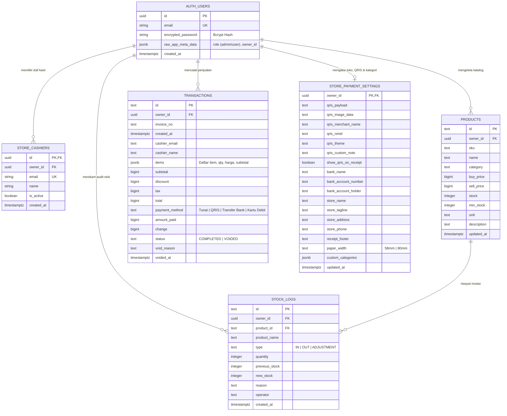

---

## 🧪 Akun Demo (Untuk Pengujian & Evaluasi)

Anda dapat masuk ke **Demo Dashboard Admin** melalui tombol **"Masuk Demo Dashboard"** pada halaman `/login`, atau masuk menggunakan salah satu kredensial berikut untuk menguji masing-masing peran:

| Peran Pengguna | Alamat Email | Kata Sandi | Hak Akses Utama |
| :--- | :--- | :--- | :--- |
| **Administrator (Pemilik Toko)** | `admin@sipb.web.id` | `admin123` | Akses penuh: Dashboard, CRUD Produk & Kategori, Mutasi Stok, POS, Laporan (CSV/Print/Void), Pengaturan Toko & Kelola Kasir. |
| **User / Staf Kasir** | `kasir@sipb.web.id` | `kasir123` | Akses terbatas khusus operasional **Terminal Kasir (POS)**, **Riwayat Shift Saya**, dan cetak struk transaksi. |

> Selain akun demo di atas, Anda juga dapat mendaftarkan workspace toko baru secara mandiri melalui tab **Daftar Admin** di halaman `/login`.

---

## 🚀 Cara Instalasi & Menjalankan di Komputer Lokal

### Prasyarat
- **Node.js** versi `18.18+` atau `20+`
- **Git**
- Proyek **Supabase** aktif (aplikasi berjalan dalam mode **Full Online**).

### Langkah Instalasi

1. **Clone repository ini dari GitHub:**
   ```bash
   git clone https://github.com/AdrianVallenz/SIPB.git
   cd SIPB
   ```

2. **Instal seluruh dependensi paket:**
   ```bash
   npm install
   ```

3. **Konfigurasi Environment Variable Supabase:**
   Buat file `.env.local` di direktori utama dan terapkan seluruh migrasi di [`./supabase/migrations`](./supabase/migrations) (serta deploy Edge Function di `./supabase/functions/tenant-auth`):
   ```env
   NEXT_PUBLIC_SUPABASE_URL=https://project-id-anda.supabase.co
   NEXT_PUBLIC_SUPABASE_ANON_KEY=anon-key-supabase-anda
   ```

4. **Jalankan server pengembangan (*development server*):**
   ```bash
   npm run dev
   ```

5. **Buka aplikasi di browser:**
   Kunjungi [http://localhost:3000](http://localhost:3000).
