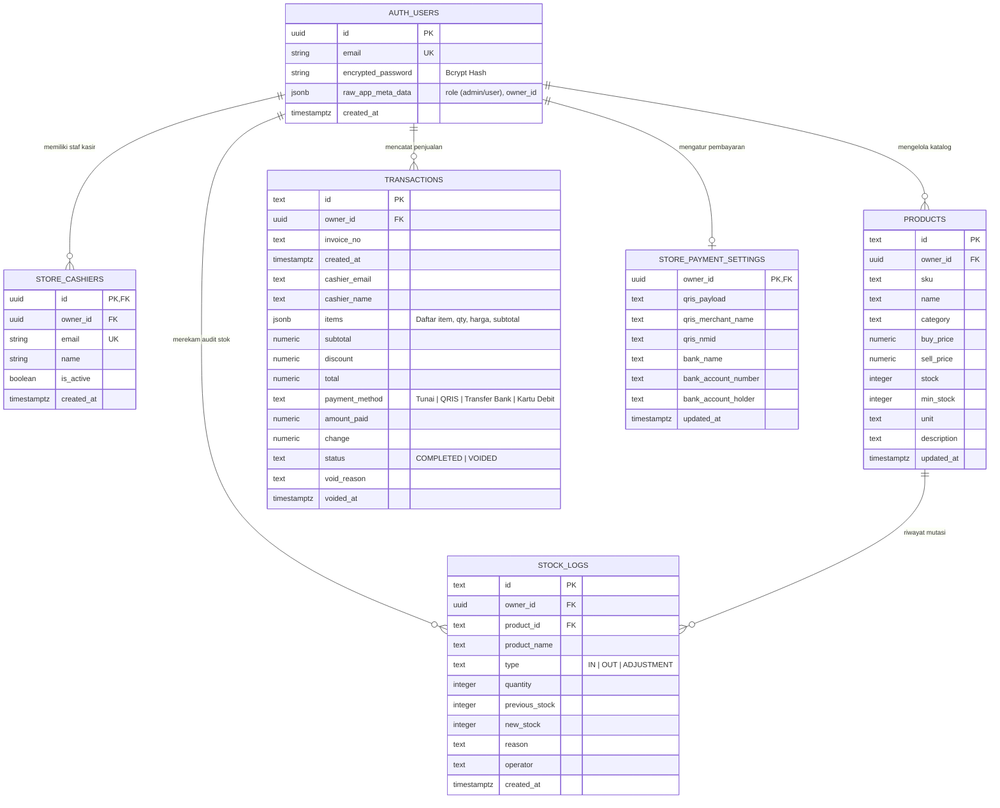
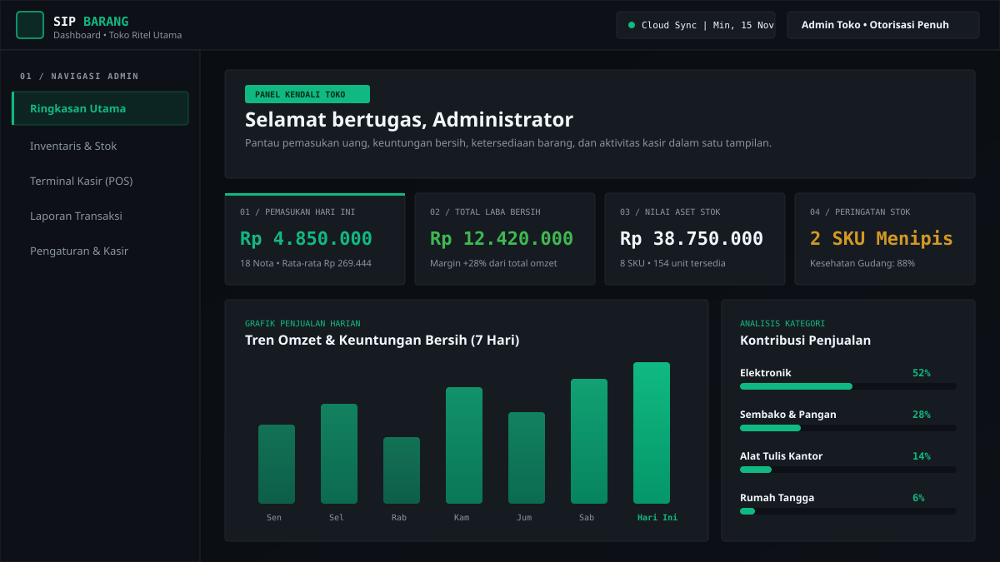
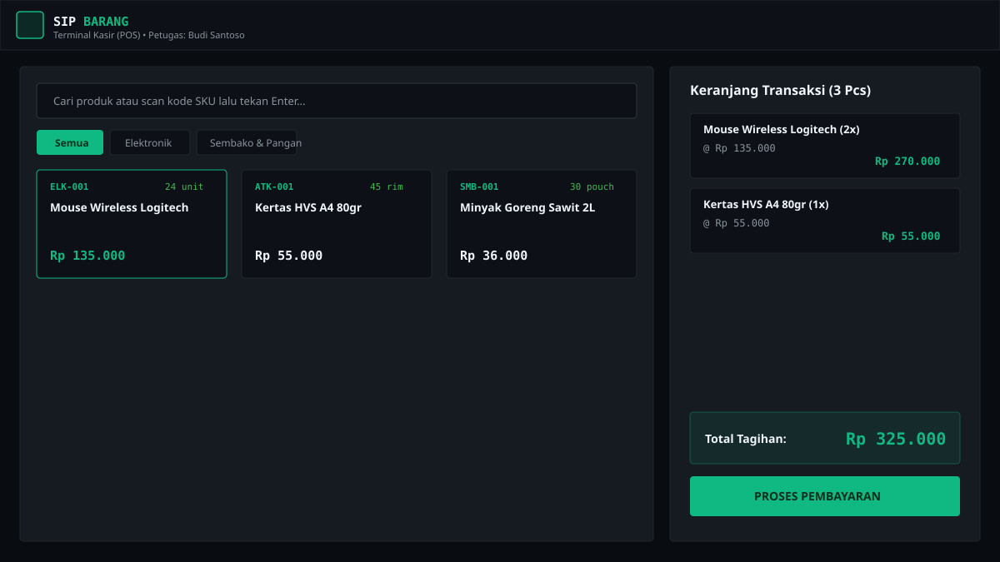

# 📦 SIP BARANG — Sistem Informasi Operasional Penjualan & Inventaris Barang (POS)

**SIP Barang** adalah aplikasi web operasional toko ritel terpadu berbasis **Next.js (TypeScript)** dan **PostgreSQL (Supabase)** yang dirancang untuk mengelola inventaris barang gudang, pencatatan mutasi stok, transaksi kasir *Point of Sale* (POS) dengan dukungan **QRIS Dinamis (EMVCo CRC-16)** & **Printer Struk Thermal Bluetooth (ESC/POS)**, serta laporan keuangan yang dapat dicetak maupun diekspor ke Excel/CSV.

---

## ✨ Fitur Utama (Berdasarkan Hak Akses Peran)

Aplikasi ini menerapkan **Role-Based Access Control (RBAC)** dengan minimal **2 peran pengguna**:

### 1. Peran Administrator / Pemilik Toko (`admin`)
- **Dashboard Analitik Real-Time**: Memantau omzet harian, laba bersih (*gross profit*), margin keuntungan, nilai aset stok gudang, tren grafik 7/14/30 hari, dan kontribusi penjualan per kategori.
- **CRUD Produk & Kategori Lengkap**: Menambah, mengubah, dan menghapus produk (SKU, harga modal, harga jual, satuan, batas stok minimum) serta mengelola kategori barang (Bawaan & Kustom).
- **Manajemen Mutasi Stok Gudang**: Mencatat barang masuk (*Restock*) dan barang keluar/rusak lengkap dengan catatan audit operator.
- **Pencarian, Filter, & Pagination**: Pencarian instan berdasarkan kode SKU/nama/nomor nota, filter kategori & status stok, serta **Pagination** dinamis (`5 / 10 / 20 / 50` baris per halaman).
- **Laporan Transaksi, Ekspor Excel (CSV), & Cetak PDF**: Merekap seluruh nota penjualan, membatalkan nota (*Void/Retur* dengan pengembalian stok otomatis), mengekspor laporan ke **CSV/Excel**, dan mencetak laporan (**Print / Save as PDF**).
- **Manajemen Akun Staf Kasir & Pembayaran**: Membuat akun login staf kasir, mengaktifkan/menonaktifkan akses kasir, serta mengatur QRIS toko dan rekening bank.

### 2. Peran Staf Kasir (`user`)
- **Terminal Kasir (POS) Cepat**: Pencarian barang, scan barcode/SKU (tekan `Enter` untuk tambah otomatis ke keranjang), filter tab kategori, dan kalkulasi diskon/kembalian uang tunai dengan pemisah ribuan otomatis (`Rp 600.000`).
- **Multi-Metode Pembayaran**: Mendukung **Tunai**, **QRIS Dinamis** (nominal tagihan otomatis terkunci pada QR), **Transfer Bank**, dan **Kartu Debit**.
- **Cetak Struk Nota**: Mencetak struk pembayaran 58mm/80mm melalui browser atau langsung ke **Printer Thermal Bluetooth**.
- **Proteksi Data Finansial**: Staf kasir hanya memiliki akses ke layar operasional POS dan **tidak dapat** melihat harga modal, laba bersih pemilik toko, maupun mengubah stok gudang secara manual.

---

## 🔐 Standar Keamanan Aplikasi

1. **Password Hashing**:
   - Akun Cloud dienkripsi menggunakan algoritma **Bcrypt** melalui **Supabase Auth (`auth.users`)**.
   - Kredensial sesi/akun lokal di-*hash* menggunakan algoritma **SHA-256 (`Web Crypto API`)** dengan *salt* khusus (`lib/storage.ts`).
2. **Proteksi SQL Injection (Parameterized Queries)**:
   - Seluruh operasi CRUD ke database PostgreSQL menggunakan **Parameterized REST/PostgREST Queries** (`lib/supabase.ts`) dan kebijakan **Row Level Security (RLS)** per toko (`database/schema.sql`).
3. **Validasi Input & Sanitasi CSV**:
   - Validasi tipe data, harga non-negatif, kuota stok, pembatasan percobaan *login* (*rate-limiting lockout* setelah 5x gagal), serta sanitasi sel CSV terhadap *Formula Injection* (`lib/format.ts`).

---

## 🗄️ Rancangan Database & Entity Relationship Diagram (ERD)

File DDL SQL lengkap tersedia di [`database/schema.sql`](./database/schema.sql).



---

## 🖼️ Tampilan Aplikasi (Screenshots)

### 1. Dashboard Analitik Administrator


### 2. Terminal Kasir (Point of Sale / POS)


---

## 🧪 Akun Demo (Untuk Pengujian Guru / Evaluator)

Anda dapat langsung menguji kedua peran (**Administrator** dan **Kasir**) pada halaman Login menggunakan tombol **"Isi Demo Admin"** / **"Isi Demo Kasir"**, atau memasukkan kredensial berikut:

| Peran Pengguna | Alamat Email | Kata Sandi | Hak Akses Utama |
| :--- | :--- | :--- | :--- |
| **Administrator (Pemilik Toko)** | `admin@sipb.web.id` | `admin123` | Akses penuh: Dashboard, CRUD Produk & Kategori, Mutasi Stok, POS, Laporan (CSV/Print), & Kelola Kasir. |
| **User / Staf Kasir** | `kasir@sipb.web.id` | `kasir123` | Akses terbatas khusus operasional **Terminal Kasir (POS)** dan cetak struk transaksi. |

> Selain akun demo di atas, Anda juga dapat mendaftarkan akun baru melalui tab **Daftar Admin** di halaman Login.

---

## 🚀 Cara Instalasi & Menjalankan di Komputer Lokal

### Prasyarat
- **Node.js** versi 18.18+ atau 20+
- **Git**

### Langkah Instalasi

1. **Clone repository ini dari GitHub:**
   ```bash
   git clone https://github.com/AdrianVallenz/SIPB.git
   cd SIPB
   ```

2. **Instal seluruh dependensi paket:**
   ```bash
   npm install
   ```

3. **Konfigurasi Environment Variable (Opsional untuk Supabase Cloud pribadi):**
   Buat file `.env.local` di direktori utama bila ingin menghubungkan ke project Supabase Anda sendiri (dan jalankan query di [`database/schema.sql`](./database/schema.sql)):
   ```env
   NEXT_PUBLIC_SUPABASE_URL=https://project-id-anda.supabase.co
   NEXT_PUBLIC_SUPABASE_ANON_KEY=anon-key-supabase-anda
   ```

4. **Jalankan server pengembangan (*development server*):**
   ```bash
   npm run dev
   ```

5. **Buka aplikasi di browser:**
   Kunjungi [http://localhost:3000](http://localhost:3000).

---

## 🎬 Panduan Alur Video Demo (2–3 Menit)

Berikut urutan skenario singkat jika Anda merekam video presentasi (2–3 menit):
1. **Menit 0:00 – 0:30 (Landing Page & Login 2 Peran):** Tampilkan halaman beranda responsif, lalu masuk menggunakan akun **Administrator** (`admin@sipb.web.id`).
2. **Menit 0:30 – 1:15 (Dashboard, CRUD Produk, Pencarian, & Pagination):** Tunjukkan ringkasan omzet di Dashboard, buka menu **Inventaris & Stok**, tambah 1 kategori/produk baru, peragakan pencarian produk, dan klik tombol **Pagination** (Halaman 1 & 2).
3. **Menit 1:15 – 2:00 (Simulasi Transaksi Kasir POS):** Keluar (*Logout*) lalu masuk sebagai **Staf Kasir** (`kasir@sipb.web.id`), pilih beberapa barang di POS, masukkan nominal uang tunai (otomatis terformat titik ribuan `Rp`), selesaikan pembayaran, dan tampilkan struk nota.
4. **Menit 2:00 – 2:45 (Laporan Transaksi, Ekspor Excel/CSV & Cetak PDF):** Masuk kembali sebagai **Admin**, buka menu **Laporan Transaksi**, klik **Ekspor CSV** (buka di Excel) dan klik **Cetak Laporan** (tampilan cetak/PDF).
